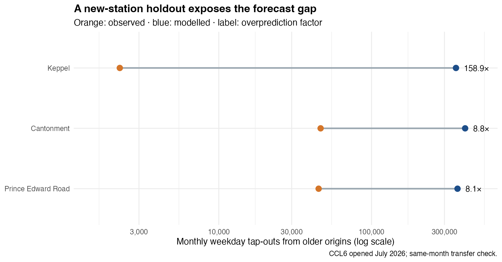

## Contents

1. Reconcile current and proposed station locations.
2. Check the geographic access change.
3. Fit station choice and test its station and new-station errors.
4. Compare new destinations and existing station shares.

::: notes
The technical report gives the data sources, code, full checks and assumptions. These slides focus on the decision and what the model can support.
:::

## The decision question

Where might existing travellers tap out when **24 JRL** and **12 CRL1** line codes are added to the rail network?

The comparison holds September 2026 trips from each current origin fixed. It changes the destinations available to those travellers, not the total number of journeys.

::: notes
The outcome is modelled destination tap-outs from existing origins. It omits future trips that start at new stations and changes in total demand.
:::

## Two networks, one physical station list

::: columns
::: {.column width="48%"}
### Current

**216 line-code records** become **184 physical stations** after interchange codes are grouped.
:::
::: {.column width="52%"}
### Proposed

The 36 proposed codes include **7 existing interchange sites**. The network therefore gains **29 new station locations**, for **213** total.
:::
:::

The July 2026 Circle Line Stage 6 opening is included. The scenario stops at CRL Phase 1 and the brief's 24 JRL codes.

::: notes
Keppel, Cantonment and Prince Edward Road were added from the September 2026 LTA station layer. Existing interchanges must not be duplicated as new destinations. The extra JS2A Forest Hill record is outside the selected 24 JRL codes.
:::

## The observed trip market

The September 2026 LTA OD file has **66.78 million weekday trips** after 238 same-station trips are excluded. All station codes match the reconciled network.

An independent LTA station-volume file reports **67.42 million weekday tap-outs**. The OD destination sum is **99.05%** of that total. The gap is disclosed; the OD market is not scaled to remove it.

::: notes
The OD file contains 475,395 weekday rows. Its 66,784,305 modelled trips are monthly totals across weekdays, not trips per weekday. The station file's gap is 637,668 trips, and the available fields do not explain it.
:::

## Where those blocks are

{height=450}

Of **13,436 HDB blocks**, **9,676** lie within 800 m of current rail. The proposed locations bring **1,319 more** inside that straight-line threshold. The clusters sit mainly in the west and north-east.

::: notes
Each building is assigned using its centroid. The count is not residents or a real walking route. Pasir Ris East has 216 newly reached blocks, Serangoon North 151, and Tengah Plantation 144. At 600 m the new count is 1,206; at 1,000 m it is 1,106. These counts do not rank future ridership.
:::

## Fitting station choice

Each current origin contributes its observed outbound trips. A destination's score uses nearby **HDB blocks**, **activity-zoned land**, **rail-line count**, **LRT-only status**, and **straight-line distance**. The scores become probabilities across all available destinations, including pairs with zero observed trips.

The model is fitted to observed OD flows. **36 origins** are held out to test prediction against a distance-only version.

::: notes
The technical report gives the conditional multinomial likelihood and utility equation. The fitted terms are 0.169 for log HDB blocks, 0.020 for log activity hectares, 1.098 for log line count, -1.897 for LRT-only stops, and 0.783 for log distance decay. The LRT flag prevents small LRT-only stops from being treated as MRT destinations. These are current-network associations.
:::

## The fit limits the claim

{height=475}

Full-month station error averages **193,826 trips**; in-sample station R² is **0.38**. On held-out origins, the station MAE is **44,604**, versus **63,740** for distance only. The model improves, but many station totals remain far from observed counts.

::: notes
Boon Lay records 1.23 million tap-outs while the model fits 368,000. Outram Park records 823,000 while the model fits 1.62 million. Held-out trip-weighted log loss is 4.857 nats per trip against 5.080 for distance only. The held-out station MAE uses only trips from withheld origins, about one-fifth of the full market, so it should not be compared directly with full-month MAE.
:::

## The new-station test fails

{height=450}

Fitted without three stations opened in July 2026, the model overpredicts their September tap-outs by **8–159 times**. This is a same-month transfer check, yet it is a strong warning against treating proposed-station allocations as opening forecasts.

::: notes
The comparison uses trips from 181 older origin stations on both sides. Keppel records 2,247 such tap-outs versus 357,064 modelled; Cantonment 46,400 versus 409,947; Prince Edward Road 45,035 versus 365,515. These stations may still be maturing. The test does not provide a universal discount for future JRL or CRL1 stations.
:::

## New destinations in the fixed market

{height=485}

The fitted model allocates **7.55 million trips** to new destinations, about **11.3%** of current-origin trips. Distance only allocates **7.59 million** overall, but individual station allocations can differ substantially. These are conditional model outputs, not opening forecasts.

::: notes
Teck Ghee, Serangoon North and Toh Guan are the highest modelled new destinations. Tukang differs by about 117,000 trips between the fitted and distance-only models. These are captured tap-outs from current origins. The calculation omits new-origin trips, future housing and jobs, schedules, and feeder-service changes.
:::

## Existing stations: a fragile interchange gain

{height=490}

Seven existing interchanges gain share in the main model because the added line raises their attraction score. **All seven lose share** if that uplift is removed. The direction of their change depends on this assumption.

::: notes
Under the main specification, Ang Mo Kio gains about 381,000 modelled trips and Outram Park loses about 220,000 versus fitted current-network trips. Changes are not relative to observed tap-outs. Without the line-count uplift, all 184 existing destinations lose some modelled share. The technical report maps origin-by-origin choice-probability changes for these two stations.
:::

## What the results support

The **1,319 newly reached HDB blocks** show a geographic access opportunity, subject to actual walking routes and block populations.

The **7.55 million allocated trips** show what the model does when new destinations enter a fixed September 2026 market. The failed new-station test and interchange sensitivity rule out treating that allocation as a planning forecast.

Use the model to test assumptions and identify places needing better travel-time, opening-stage employment, housing and feeder-bus data before making a patronage claim.

::: notes
The report includes the independent station-volume reconciliation, a spatial residual audit, origin-market map, model equations and scenario files. The residuals show geographic clustering (six-neighbour Moran's I = 0.13, permutation p = 0.003), suggesting omitted spatial factors without identifying their cause. Future-origin demand and induced trips require a separate forecast.
:::
