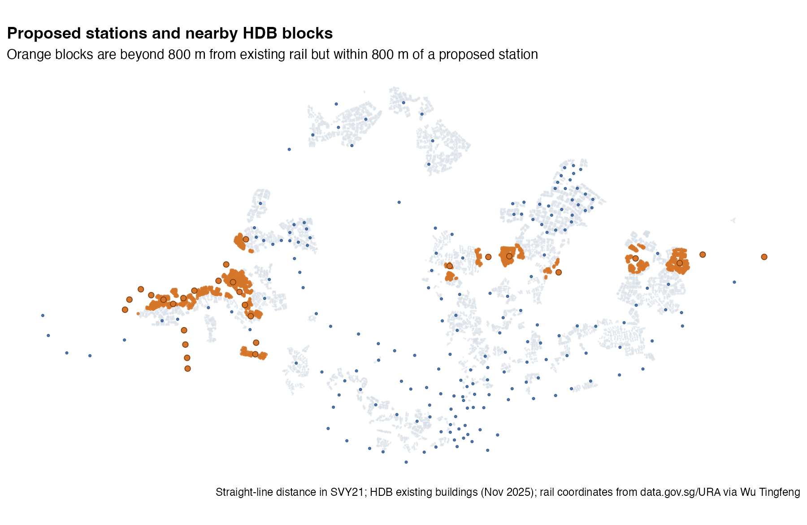
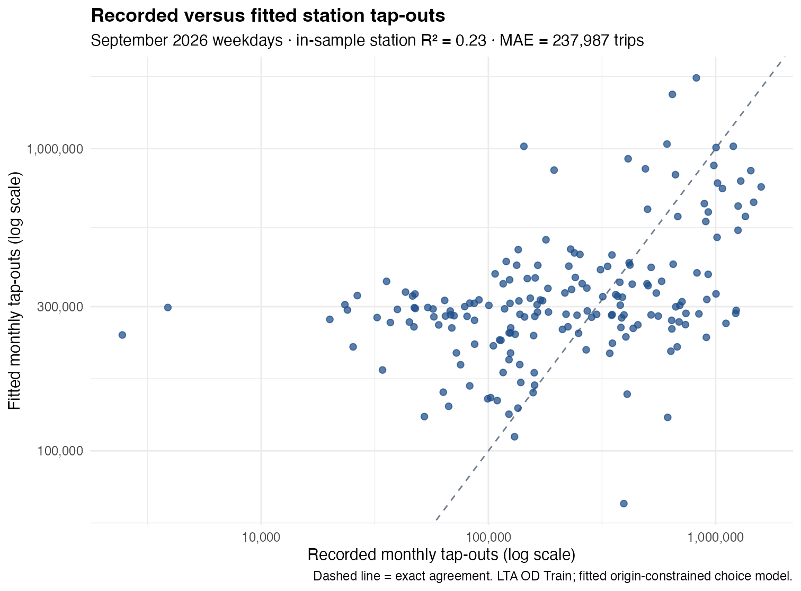
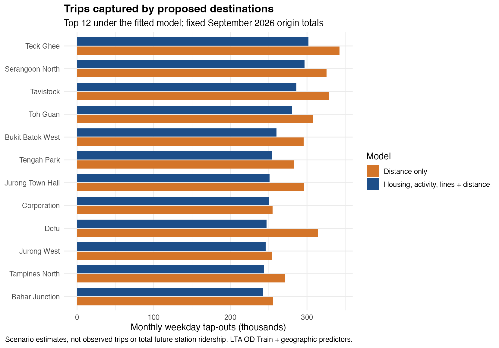
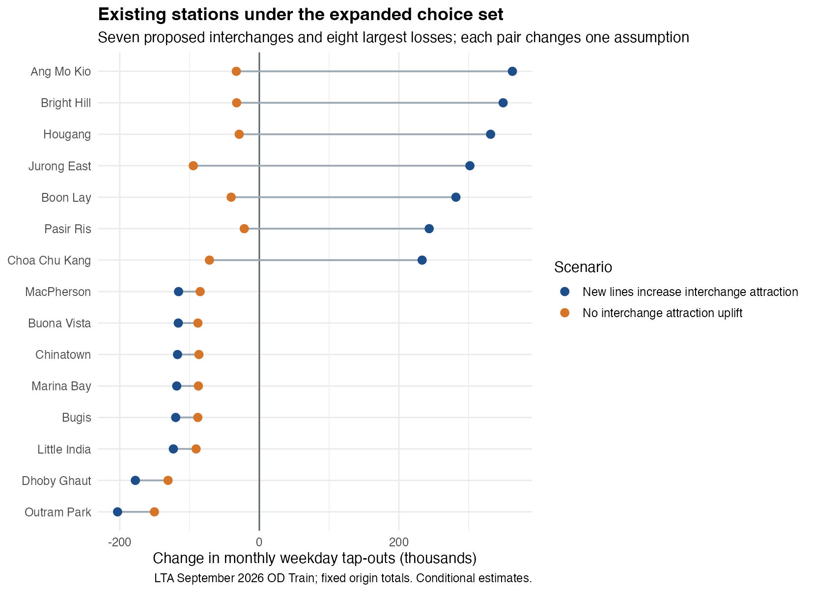

## Contents

1. Reconcile current and proposed station locations.
2. Check the geographic access change.
3. Fit station choice to observed LTA trips and test its error.
4. Compare new destinations and existing station shares.

::: notes
The technical report gives the data sources, code, full checks and assumptions. These slides focus on the decision and what the model can support.
:::

## The decision question

Where might existing travellers tap out when **24 JRL** and **12 CRL1** line codes are added to the rail network?

The comparison holds September 2026 trips from each current origin fixed. It changes the destinations available to those travellers, not the total number of journeys.

::: notes
The outcome is modelled destination tap-outs from existing origins. It omits future trips that start at new stations and changes in total demand.
:::

## Two networks, one physical station list

::: columns
::: {.column width="48%"}
### Current

**216 line-code records** become **184 physical stations** after interchange codes are grouped.
:::
::: {.column width="52%"}
### Proposed

The 36 proposed codes include **7 existing interchange sites**. The network therefore gains **29 new station locations**, for **213** total.
:::
:::

The July 2026 Circle Line Stage 6 opening is included. The scenario stops at CRL Phase 1 and the brief's 24 JRL codes.

::: notes
Keppel, Cantonment and Prince Edward Road were added from the September 2026 LTA station layer. Existing interchanges must not be duplicated as new destinations. The extra JS2A Forest Hill record is outside the selected 24 JRL codes.
:::

## The observed trip market

The September 2026 LTA OD file has **66.78 million weekday trips** after 238 same-station trips are excluded. All station codes match the reconciled network.

An independent LTA station-volume file reports **67.42 million weekday tap-outs**. The OD destination sum is **99.05%** of that total. The gap is disclosed; the OD market is not scaled to remove it.

::: notes
The OD file contains 475,395 weekday rows. Its 66,784,305 modelled trips are monthly totals across weekdays, not trips per weekday. The station file's gap is 637,668 trips, and the available fields do not explain it.
:::

## The local access screen

Of **13,436 completed HDB blocks**, **9,676** have centroids within 800 m of a current station. Another **1,319 blocks** cross that threshold when the proposed locations are added.

The calculation is straight-line distance from a block centroid. It counts neither residents nor actual walking routes.

::: notes
At 600 m the new count is 1,206 blocks; at 1,000 m it is 1,106. More blocks are already within the wider current-network radius, so the incremental count falls. The threshold is an access screen, not a passenger market boundary.
:::

## Where those blocks are

{height=515}

The newly reached blocks cluster around proposed stops in the west and north-east.

::: notes
Each building is assigned using its centroid. Pasir Ris East has 216 newly reached blocks, Serangoon North 151, and Tengah Plantation 144. These counts do not rank future ridership.
:::

## Fitting station choice

Each current origin contributes its observed outbound trips. A destination's score uses nearby **HDB blocks**, **activity-zoned land**, **rail-line count**, and **straight-line distance**. The scores become probabilities across all available destinations, including pairs with zero observed trips.

The model is fitted to observed OD flows. **36 origins** are held out to test prediction against a distance-only version.

::: notes
The technical report gives the conditional multinomial likelihood and exact utility equation. The fitted terms are 0.100 for log HDB blocks, 0.162 for log activity hectares, 1.278 for log line count and 0.765 for log distance decay. These are associations from the current network.
:::

## The fit limits the claim

{height=475}

Station error averages **237,987 monthly trips**; in-sample station R² is **0.23**. Held-out log loss improves over distance only (**4.947 versus 5.080** nats per trip), but many station totals remain far from observed counts.

::: notes
Boon Lay records 1.23 million tap-outs while the model fits about 285,000. Outram Park records 823,000 while the model fits 1.71 million. The model adds information to a distance-only benchmark, yet it is not an accurate station-level forecast.
:::

## New destinations in the fixed market

{height=485}

The fitted model allocates **6.29 million trips** to new destinations, about **9.4%** of current-origin trips. Distance only allocates **7.59 million**. The gap reflects model choice, not a confidence interval.

::: notes
Teck Ghee, Serangoon North and Tavistock are the highest modelled new destinations. These are captured tap-outs from current origins. The calculation omits new-origin trips, future housing and jobs, schedules, and feeder-service changes.
:::

## Existing stations: a fragile interchange gain

{height=490}

Seven existing interchanges gain share in the main model because the added line raises their attraction score. **All seven lose share** if that uplift is removed. The direction of their change depends on this assumption.

::: notes
Under the main specification, Ang Mo Kio gains about 363,000 modelled trips and Outram Park loses about 202,000 versus fitted current-network trips. Changes are not relative to observed tap-outs. Without the line-count uplift, all 184 existing destinations lose some modelled share.
:::

## What the results support

The **1,319 newly reached HDB blocks** show a geographic access opportunity, subject to actual walking routes and block populations.

The **6.29 million allocated trips** show what the fitted model does when new destinations enter a fixed September 2026 market. Its station errors and interchange sensitivity are too large to treat that allocation as a planning forecast.

Use the model to test assumptions and identify places needing better travel-time, employment, housing and feeder-bus data before making a patronage claim.

::: notes
The report includes the full station map, independent station-volume reconciliation, model equations, coefficients and scenario files. Future-origin demand and induced trips require a separate forecast.
:::
