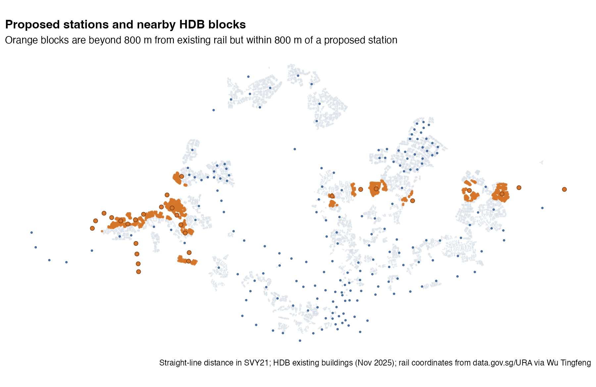
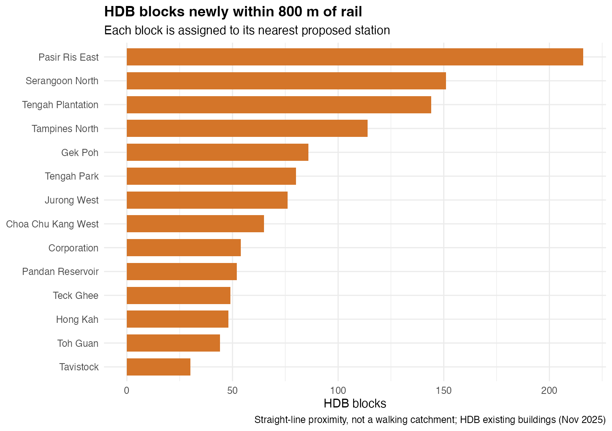
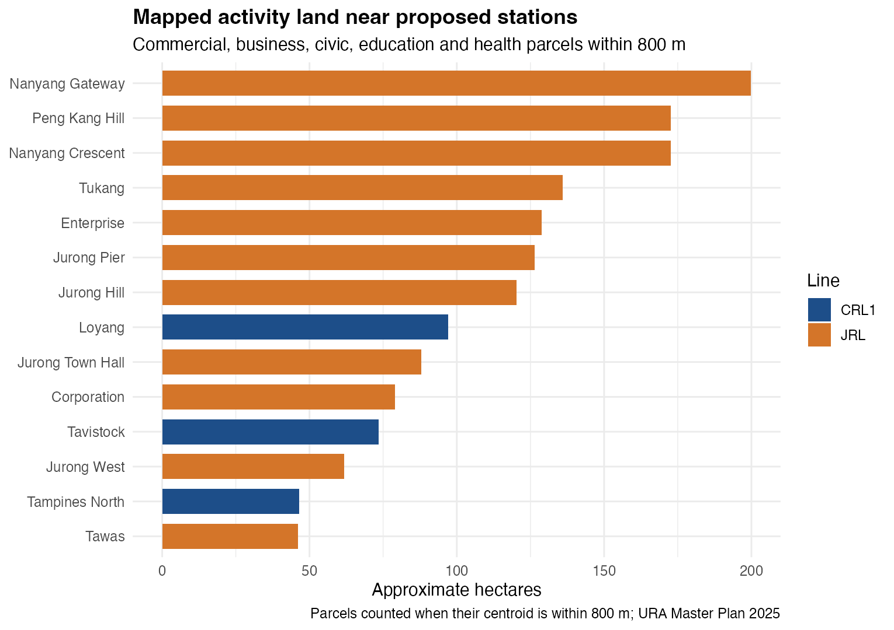
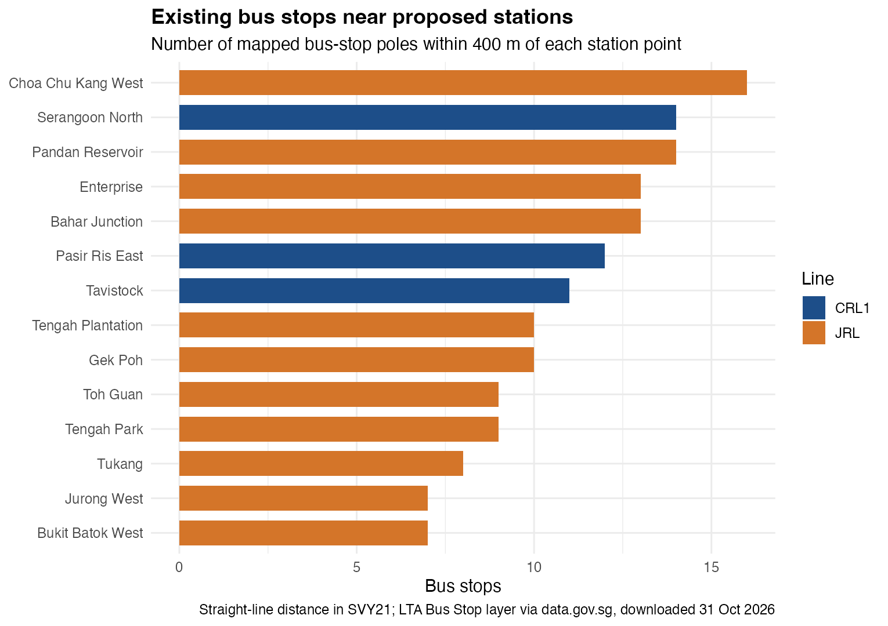
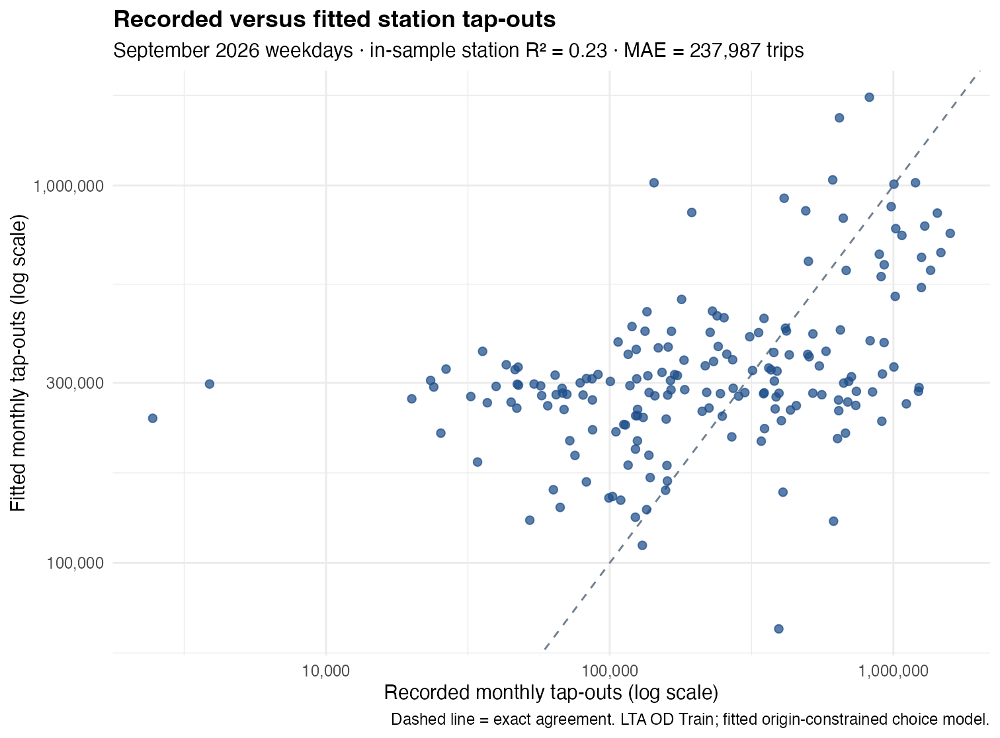
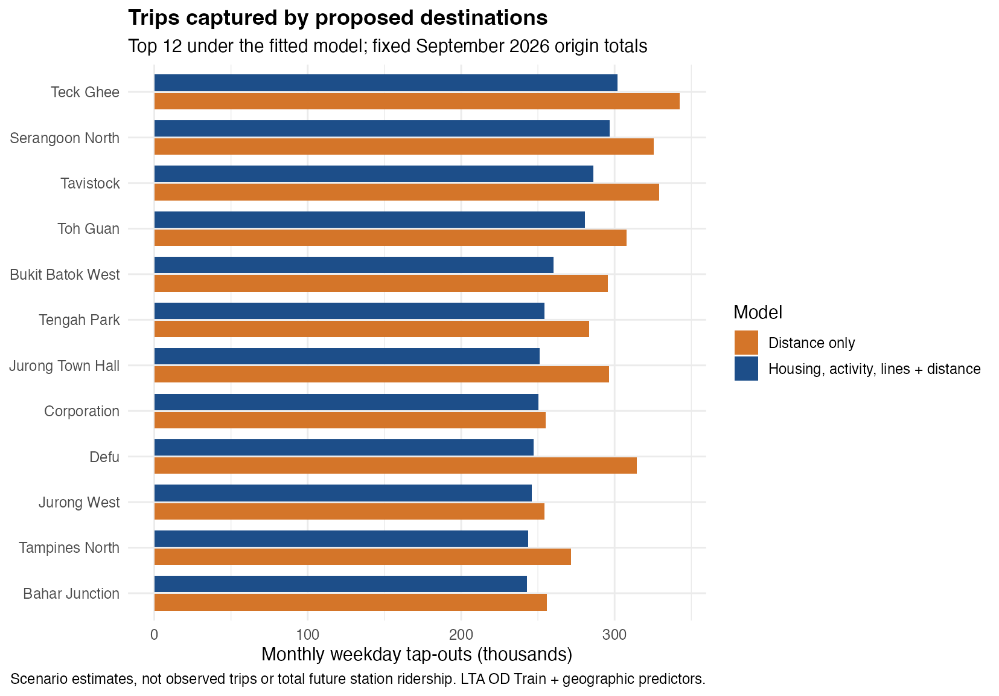
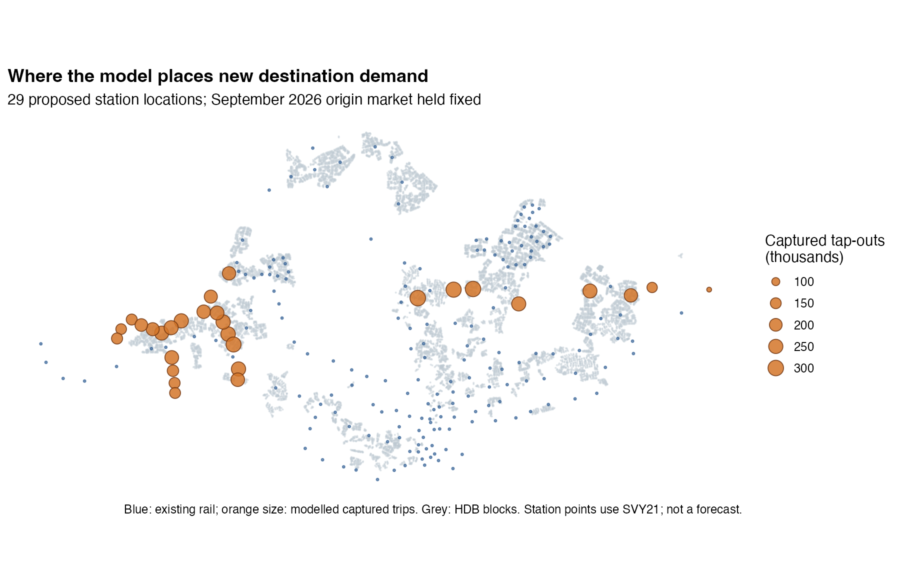
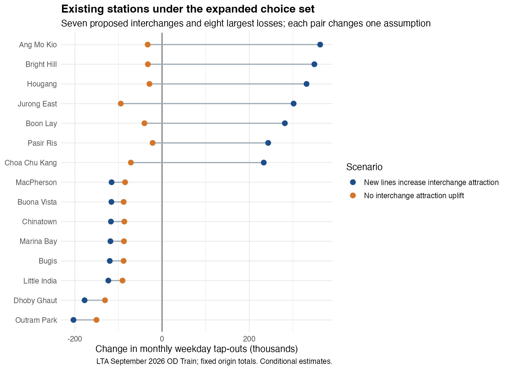

```{r}
#| label: load-analysis
#| include: false
# Rendering uses the checked result files. Recompute only when the private
# LTA extracts are available locally; the account key is never embedded here.
if (params$recompute) {
  source("R/prepare_geography.R")
  source("R/model.R")
  source("R/plot_model.R")
}
coverage <- read.csv("results/coverage-summary.csv")
features <- read.csv("results/station-features.csv")
new_coverage <- read.csv("results/new-station-coverage.csv")
line_coverage <- read.csv("results/line-coverage.csv")
sensitivity <- read.csv("results/distance-sensitivity.csv")
model_dir <- "results/model"
checks <- read.csv(file.path(model_dir, "checks.csv"))
coefficients <- read.csv(file.path(model_dir, "coefficients.csv"))
pred <- read.csv(file.path(model_dir, "station-predictions.csv"))
station_reconciliation <- read.csv(file.path(model_dir, "station-volume-reconciliation.csv"))
fit_existing <- pred |> dplyr::filter(status == "Existing")
fit_r2 <- 1 - sum((fit_existing$observed_ridership - fit_existing$estimated_existing)^2) /
  sum((fit_existing$observed_ridership - mean(fit_existing$observed_ridership))^2)
fmt <- function(x) format(x, big.mark = ",", trim = TRUE, scientific = FALSE)
```

[Submission hub](Take-home_Ex03.qmd) · [Executive summary](Executive-summary.qmd) · [Project source](https://github.com/davincuaso/ISSS608-VAA/tree/master/Take-home_Ex/Take-home_Ex03)

## Overview

The question is whether adding the Jurong Region Line (JRL) and the first phase of the Cross Island Line (CRL1) changes where rail users are likely to board and alight. A station does not draw passengers from a fixed circle. Travellers can choose among several stations, and the choice depends on the station's setting and on the cost of reaching it. I use a probabilistic station-choice model for that comparison, with separate current and proposed networks.

The model is fitted to LTA's September 2026 train origin–destination (OD) counts. Its station-level fit is weak despite improving on a distance-only reference for held-out origins. I therefore report the proposed-network numbers as **conditional redistribution estimates**, alongside model error and sensitivity to the interchange assumption. They are not a forecast of all future journeys.

The [official brief](https://isss626-ay2026-27aug.netlify.app/take-home_ex03) calls for two interaction frames, origin market potential, destination observed ridership and attraction measures, calibration, validation, future-station prediction, and a comparison of existing station market areas. The project is organised around those outputs.

## Study questions and units

1. How many distinct station locations are in the current and proposed networks?
2. Which HDB blocks gain straight-line proximity to rail under the proposed network?
3. How well can a model using local activity, connectivity and distance reproduce observed station-level tap-outs?
4. Holding the observed origin market fixed, which destinations could gain or lose share when proposed stations enter the choice set?

The model's unit is a **directed origin–destination station pair** for September 2026, restricted to the `WEEKDAY` day type. Station-level ridership means recorded destination tap-outs summed across those pairs. In the geographic audit, a “station” is one physical location; the line codes of an interchange are grouped under one station name.

## Data sources and their roles

```{r}
#| label: data-sources
knitr::kable(data.frame(
  Source = c("Current and future station coordinates", "HDB Existing Building",
             "LTA Bus Stop", "Master Plan 2025 Land Use Layer",
             "LTA OD Train", "LTA Passenger Volume by Train Stations"),
  Snapshot = c("March 2026 compilation + September 2026 LTA layer", "Nov 2025",
               "Downloaded 31 Oct 2026", "Gazetted Dec 2025",
               "Sep 2026", "Sep 2026"),
  Role = c("Station locations and scenario codes", "Residential-building count and proximity",
           "Bus-stop poles near proposed stations", "Mapped activity area near destinations",
           "Observed weekday station-to-station trips", "Independent tap-out reconciliation")
), col.names = c("Dataset", "Time reference", "Use"))
```

The [station coordinate repository](https://github.com/elliotwutingfeng/singapore_train_station_coordinates) provides the saved current and future station CSVs. It derives most points from URA or LTA records and flags manual estimates. Because that snapshot predates the July 2026 opening of [Circle Line Stage 6](https://www.lta.gov.sg/content/ltagov/en/upcoming_projects/rail_expansion/circle_line_6.html), I add Keppel, Cantonment and Prince Edward Road using centroids of their polygons in LTA's September 2026 Train Station layer. I also replace the former `CE1` and `CE2` codes with `CC34` and `CC33` for Bayfront and Marina Bay. The [HDB](https://data.gov.sg/datasets/d_16b157c52ed637edd6ba1232e026258d/view), [bus-stop](https://data.gov.sg/datasets/d_3f172c6feb3f4f92a2f47d93eed2908a/view) and [Master Plan land-use](https://data.gov.sg/datasets/d_a8c3546b26712e35021f3a681d0353ae/view) layers are downloaded from data.gov.sg.

These choices use five of the brief's six recommended data roles. [OpenStreetMap POIs via Geofabrik](https://download.geofabrik.de/asia/malaysia-singapore-brunei.html) were considered but not added: POI tagging and completeness vary by place, while the Master Plan layer provides a consistent island-wide zoning measure. Zoning still cannot be read as observed employment or visits.

The September OD Train and station-volume ZIPs were downloaded on 6 November 2026 through [LTA DataMall](https://datamall.lta.gov.sg/content/datamall/en/dynamic-data.html). The [API guide](https://datamall.lta.gov.sg/content/dam/datamall/datasets/LTA_DataMall_API_User_Guide.pdf) defines their fields and monthly release cycle. The raw ZIPs and Account Key are excluded from Git; `R/download_lta.R` reads the key from an environment variable. The checked aggregate outputs are saved under `results/model/`.

## Preparing the station scenarios

The reconciled current CSV has **216 line-code records**. Grouping records with the same physical station name gives **184 existing station locations**. For the proposed scenario I retain `JS1–JS12`, `JW1–JW5`, and `JE1–JE7` (24 JRL codes) plus `CR2–CR13` (12 CRL1 codes). This matches the assignment's 24 plus 12 scope and [LTA's CRL1 phase description](https://www.lta.gov.sg/content/ltagov/en/upcoming_projects/rail_expansion/cross_island_line.html). The extra `JS2A` Forest Hill record in the future coordinate file is excluded from this fixed 24-code JRL scenario. CRL Phase 2 and its Punggol extension are also excluded because they are outside CRL1.

Seven proposed codes refer to existing interchange locations: Choa Chu Kang, Boon Lay, Jurong East, Pasir Ris, Hougang, Ang Mo Kio and Bright Hill. They add a line connection but not another destination point. The result is **29 new physical locations**, giving **213 existing-plus-proposed stations**. Double-counting an interchange as two destinations would inflate its predicted share, so the station-name grouping matters.

```{r}
#| label: station-audit
knitr::kable(coverage[1:3, ], col.names = c("Check", "Count"))
```

The coordinates are converted from longitude and latitude (EPSG:4326) to SVY21 / Singapore TM (EPSG:3414) before distance calculations. In this projected system, the station-to-station and building-to-station distances are in metres. I validate missing coordinates, duplicate station codes, and the expected JRL/CRL1 code counts before any result is written.

## Geographic measures

### Residential blocks within reach

I take the centroid of each completed HDB building polygon and find its nearest existing and proposed station. An 800 m threshold is a simple spatial screen: it asks whether a block's mapped centre lies within 800 m in a straight line. The count is not a population estimate, because blocks differ in floor count and household size. It also does not measure an actual walking route.

```{r}
#| label: coverage-counts
knitr::kable(coverage[4:6, ], col.names = c("Measure", "HDB blocks"))
```

Of 13,436 buildings, **9,676** are within 800 m of an existing physical station. The scenario adds **1,319** buildings to that threshold. A further 2,110 buildings are nearer to a proposed station than to any current one, whether or not they cross the 800 m line. These two figures answer different questions: new threshold coverage versus a shorter straight-line distance.

```{r}
#| label: coverage-map

```

The newly covered blocks are concentrated around planned stops in the west and north-east. The west contains much of the JRL extension's residential catchment, while the eastern CRL1 stations add pockets around Pasir Ris East and Tampines North. This map is a *geographic opportunity* measure, not a forecast of journeys: some blocks may already reach rail by bus, and an apparently close station may require a longer walk around barriers.

```{r}
#| label: line-coverage
knitr::kable(line_coverage,
             col.names = c("Nearest proposed line", "Newly reached HDB blocks"))
```

The line totals assign each newly reached building to its closest new station. They should not be read as a benefit–cost comparison of the two projects: the lines serve different places, and HDB buildings exclude private housing and many work destinations.

```{r}
#| label: new-blocks-chart

```

Pasir Ris East has the largest count in this measure (216), followed by Serangoon North (151) and Tengah Plantation (144). The chart assigns each newly reached block to its nearest proposed station, so a block is counted once. It does not imply that these will be the busiest new stations. Business districts and interchange stations can draw riders from much farther away than the surrounding HDB blocks.

### Sensitivity to the threshold

```{r}
#| label: threshold-check
knitr::kable(sensitivity, col.names = c("Radius (m)", "Existing blocks reached", "Newly reached blocks"))
```

The 800 m result is not a natural boundary. The table repeats the same centroid calculation at 600 m and 1,000 m. A larger radius includes more buildings but also accepts walks that may be unattractive or impossible in practice. The model itself uses continuous station-to-station distance rather than treating these circles as a rigid passenger market.

### Destination activity proxy

For each station, I count HDB block centroids and sum the area of mapped commercial, business, civic, education, health, hotel and mixed-use parcels whose centroids fall within 800 m. The land-use layer records **zoning**, not occupied jobs or realised visits. A large parcel whose centre lies just inside the circle is counted in full, so the figure is an approximate activity proxy. The two measures are kept separate in the model: one describes nearby housing blocks; the other describes mapped non-residential opportunities.

```{r}
#| label: activity-chart

```

The activity ranking differs from the HDB-block ranking. That is the reason to include both predictors: a station serving industrial or commercial land could attract destination trips even with few completed HDB blocks nearby. The chart does not tell us how many workers or visitors use those parcels.

```{r}
#| label: activity-preview
preview <- features |>
  dplyr::filter(status == "Planned new") |>
  dplyr::arrange(dplyr::desc(activity_hectares_800m)) |>
  dplyr::select(station, hdb_blocks_800m, activity_hectares_800m) |>
  head(8)
knitr::kable(preview, digits = 1,
             col.names = c("Proposed station", "HDB blocks (800 m)", "Activity land (ha, approximate)"))
```

### Nearby bus stops

The LTA bus-stop layer has 5,205 unique stop codes. For each of the 29 new physical station locations, I count mapped stop poles within 400 m of the station point. This is a different check from the 800 m HDB building screen: it describes nearby bus infrastructure, not the number of residents or a catchment of passengers.

```{r}
#| label: bus-stop-chart

```

Choa Chu Kang West has 16 mapped stops within 400 m; Pandan Reservoir and Serangoon North have 14 each. The [complete station table](https://github.com/davincuaso/ISSS608-VAA/blob/master/Take-home_Ex/Take-home_Ex03/results/new-station-bus-stops.csv) includes all 29 locations. These counts cannot distinguish a busy transfer point from a group of lightly served roadside stops. Routes, headways, stop direction and walking connections would be needed before treating bus access as a behavioural predictor.

## Checking the LTA trip extracts

The OD ZIP contains 887,478 rows across both day types. I retain its **475,395 weekday rows**, which sum to 66,784,543 trips. The station-code join resolves every recorded trip after adding Circle Line Stage 6 and the `CC33`/`CC34` aliases. Same-station rows account for just 238 trips; these are excluded because the interstation distance term does not represent them. The modelled market is therefore **66,784,305 weekday trips across 184 origins**.

```{r}
#| label: od-quality-checks
knitr::kable(data.frame(
  Check = c("Weekday OD rows", "Weekday OD trips before same-station exclusion",
            "Matched code share", "Excluded same-station trips",
            "Trips in the model", "Independent station-file tap-outs"),
  Result = c(fmt(checks$raw_weekday_rows), fmt(checks$raw_weekday_trips),
             sprintf("%.2f%%", 100 * checks$matched_trip_share),
             fmt(checks$excluded_same_station_trips), fmt(checks$observed_trips),
             fmt(checks$station_tapouts))
), col.names = c("Audit", "September 2026 weekday result"))
```

LTA's separate station-volume ZIP reports 67,421,973 weekday tap-outs for the same 184 stations. The OD destinations sum to **99.05%** of that total, a gap of 637,668 trips. The two published files are close but not identical, and their fields do not explain the difference. I keep the OD totals as the model's market and publish the station-by-station reconciliation in `results/model/station-volume-reconciliation.csv`; I do not scale one file to force agreement with the other.

## Interaction data and observed market potential

The model script constructs a full directed choice table rather than using only pairs that appear in the OD CSV. Zero-flow pairs must remain in the choice set; otherwise the denominator in a station-choice probability would be calculated from observed trips alone. A same-station trip is removed because its zero spatial distance is not meaningful for this interstation model. Distances use station points in SVY21; they are **not** rail travel times or network path lengths.

```{r}
#| label: interaction-schema
knitr::kable(data.frame(
  Table = c("Current interactions", "Proposed interactions", "Origins", "Destinations"),
  Key = c("origin + destination", "origin + destination", "origin", "destination"),
  Fields = c("observed trips, attraction, distance_km, probability",
             "attraction, distance_km, probability",
             "observed outbound weekday trips = market_potential",
             "observed inbound weekday trips, HDB blocks, activity area, line count")
), col.names = c("Data frame", "Join key", "Principal columns"))
```

LTA merges some interchange codes in the OD file (for example `CC1-NE6-NS24`). `R/model.R` splits these codes and maps their components to one physical station name. It writes an unmatched-code audit and stops if those records carry more than 5% of trips. It also checks one `YEAR_MONTH`, valid hourly values and non-negative trip counts. Only `WEEKDAY` and `TRAIN` rows enter this version of the model. An origin total is a monthly aggregate across weekdays, not a per-day rate.

## Calibration and validation

For an origin *i* and available destination *j*, the station-choice utility is

$$
U_{ij}=\beta_H\log(1+H_j)+\beta_A\log(1+A_j)+\beta_L\log(L_j)-\beta_D\log(d_{ij}+0.25),
\qquad
P_{ij}=\frac{\exp(U_{ij})}{\sum_{k\ne i}\exp(U_{ik})}.
$$

Here $H_j$ is HDB block count within 800 m, $A_j$ is approximate activity hectares, $L_j$ is the number of rail lines, and $d_{ij}$ is straight-line distance in kilometres. The 0.25 km offset keeps the distance term finite at very short separations. The four coefficients are fitted by maximising the conditional multinomial likelihood of observed OD trips. The coefficient bounds enforce non-negative attraction effects and non-negative distance decay; a boundary estimate would warn that a predictor may add little information. These are modelling choices, not measured behavioural constants.

I reserve 20% of origin stations, selected with seed 626, before fitting. Their trip-weighted log loss is compared with a fitted distance-only model. The final coefficients are then refitted to all observed origins. For the current network, estimated destination tap-outs are the sum of each origin's observed market potential multiplied by its destination probabilities. The code checks that probabilities sum to one per origin and that total estimated trips equal the observed trip total.

```{r}
#| label: fitted-coefficients
knitr::kable(coefficients, digits = 3,
             col.names = c("Model term", "Fitted coefficient"))
```

All four estimated coefficients are positive under the stated sign constraints. The line-count coefficient is the largest, but it may absorb features of current interchange locations that will not transfer to new lines. It is an association in this model, not evidence that adding a line causes a proportional increase in tap-outs.

```{r}
#| label: model-quality
knitr::kable(data.frame(
  Measure = c("Held-out origins", "Held-out loss, fitted model (nats/trip)",
              "Held-out loss, distance only (nats/trip)",
              "In-sample station MAE (trips)", "In-sample station R²"),
  Value = c(checks$heldout_origins, sprintf("%.3f", checks$heldout_logloss_per_trip),
            sprintf("%.3f", checks$distance_only_logloss_per_trip),
            fmt(round(checks$station_mae)), sprintf("%.2f", fit_r2))
), col.names = c("Validation measure", "Result"))
```

The fitted model improves held-out origin log loss by 0.133 nats per trip over the distance-only reference. That is useful evidence that the geographic predictors add information. Station-level fit is nevertheless weak: the in-sample MAE is **237,987 monthly trips**, about **66% of the mean observed station total**, and $R^2$ is **0.23**. For example, Boon Lay records about 1.23 million tap-outs but the model fits only 285,000; Outram Park records 823,000 but the model fits 1.71 million. These errors limit the credibility of the new-station point estimates.

```{r}
#| label: model-fit-chart

```

The dashed diagonal marks exact agreement. Many stations lie far from it, including some of the busiest. The model is therefore a transparent *scenario baseline*, not a high-accuracy station forecast.

## Proposed-network comparison

The first counterfactual holds each **existing origin's observed outbound trip total fixed** and adds the 29 distinct new station locations as possible destinations. Existing interchanges gain their proposed line connection. The fitted coefficients stay unchanged. This isolates a change in destination choice under the expanded set of stations. It does **not** estimate new trips generated by future housing, trips starting at new stations, or transfers inside paid rail areas. New-station figures are captured tap-outs from existing origins, not total future station ridership.

```{r}
#| label: proposed-station-ranking
top_new <- pred |>
  dplyr::filter(status == "Planned new") |>
  dplyr::arrange(dplyr::desc(estimated_scenario)) |>
  dplyr::select(destination, estimated_scenario) |>
  head(5)
top_new$estimated_scenario <- fmt(round(top_new$estimated_scenario))
knitr::kable(top_new,
             col.names = c("Proposed destination", "Captured monthly weekday tap-outs"))
```

The fitted model allocates **6.29 million** of the fixed 66.78 million weekday trips to new destinations, about **9.4%** of the current-origin market. Teck Ghee, Serangoon North and Tavistock rank highest under this specification. A distance-only version allocates **7.59 million** trips to new destinations. The 1.30 million difference shows that the estimates depend materially on how destination attraction is represented; it is **not** a statistical confidence interval.

```{r}
#| label: proposed-station-comparison-chart

```

```{r}
#| label: proposed-station-map

```

The map locates the scenario estimates against the current station network and HDB blocks. The marker sizes should be read with the fit errors above in mind; the model does not know the eventual train schedule, future jobs or housing, or trips originating at the new stations.

### Existing station market shares and interchange sensitivity

Under the main specification, seven existing interchanges gain modelled destination trips because their proposed line increases `line_count`; the other 177 existing stations lose share to the expanded choice set. Ang Mo Kio gains about 363,000 modelled tap-outs, while Outram Park loses about 202,000. These changes are relative to **fitted current-network trips**, not directly to observed tap-outs.

```{r}
#| label: existing-market-change-chart

```

The paired points change one assumption: if the seven interchanges retain their current attraction score, **all 184 existing destinations lose modelled share**, including those seven. New destinations then capture **6.56 million** trips rather than 6.29 million. The reversal at interchange stations is a warning against reading the blue gains as a firm operational forecast. The model is transferring a present-day line-count association to future interchanges without evidence about future transfer behaviour.

The interaction files retain `origin`, `destination`, attraction, `distance_km` and probabilities for both networks; `results/model/station-predictions.csv` contains the public station-level summary. The fixed origin totals make scenario trips sum to the observed 66.78 million in every specification. Gains at new destinations must therefore be balanced by losses elsewhere; the exercise cannot infer induced systemwide rail demand from this setup.

## Assumptions and limitations

Most station points come from a secondary coordinate compilation. The three newly opened Circle Line points are centroids of LTA station polygons, not entrance locations. Neither source necessarily places a passenger's actual access point. The `JS2A` omission follows the brief's 24-code JRL scope rather than claiming the station is not planned. Grouping line codes by station name gives distinct locations but hides platform paths and transfer arrangements.

HDB block counts are not residents. Master Plan zoning is not employment or footfall. The 800 m land-use summary uses parcel centroids and whole parcel areas, which can overstate nearby activity for large sites. Bus-stop locations do not show service frequency, capacity or transfer demand; the 400 m count is descriptive and does not enter the station-choice utility. Straight-line distance ignores rail routes, travel time and station entrances. The OD file counts entry-to-exit fare transactions, not every passenger moving through an interchange. The separate LTA station file has 637,668 more weekday tap-outs than the OD destination sum; the available fields do not establish why.

The model misses large station totals even on its training month: its station MAE is 237,987 trips and its in-sample $R^2$ is 0.23. In particular, the apparent gains at seven interchanges disappear when the proposed lines are not given an automatic attraction uplift. The fixed-origin counterfactual omits trips starting at new stations, new housing and jobs, feeder-service changes, operating dates and induced trips. Its 6.29 million new-station allocation is therefore an assumption-dependent redistribution within the September 2026 market, not a forecast with a statistical uncertainty interval. The OD data cover MRT and LRT stations together; the model does not separate the two modes' choice processes.

## Conclusion

The geographic scenario adds 29 distinct station locations after interchange codes are reconciled. In the HDB building layer, 1,319 blocks cross the 800 m straight-line proximity threshold, with the largest groups near Pasir Ris East, Serangoon North and Tengah Plantation. September 2026 OD data provide 66.78 million weekday trips for calibration. Under a fixed-origin market, the fitted model assigns 6.29 million of those trips to proposed destinations. Its large station-level errors and sensitivity to the interchange rule mean that figure is useful as a stress test of the assumptions, not as a planning forecast. The HDB access result is more direct, although it too is limited by straight-line distance and building rather than resident counts.

## References

- ISSS626 course team. [Take-home Exercise 3 brief](https://isss626-ay2026-27aug.netlify.app/take-home_ex03).
- Land Transport Authority. [Jurong Region Line](https://www.lta.gov.sg/content/ltagov/en/upcoming_projects/rail_expansion/jurong_region_line.html), [Cross Island Line](https://www.lta.gov.sg/content/ltagov/en/upcoming_projects/rail_expansion/cross_island_line.html), and [Circle Line Stage 6](https://www.lta.gov.sg/content/ltagov/en/upcoming_projects/rail_expansion/circle_line_6.html).
- Land Transport Authority. [DataMall dynamic datasets](https://datamall.lta.gov.sg/content/datamall/en/dynamic-data.html) and [API User Guide](https://datamall.lta.gov.sg/content/dam/datamall/datasets/LTA_DataMall_API_User_Guide.pdf).
- Housing & Development Board. [HDB Existing Building, November 2025](https://data.gov.sg/datasets/d_16b157c52ed637edd6ba1232e026258d/view).
- Land Transport Authority. [LTA Bus Stop](https://data.gov.sg/datasets/d_3f172c6feb3f4f92a2f47d93eed2908a/view).
- Urban Redevelopment Authority. [Master Plan 2025 Land Use Layer](https://data.gov.sg/datasets/d_a8c3546b26712e35021f3a681d0353ae/view).
- Wu Tingfeng. [Singapore Train Station Coordinates](https://github.com/elliotwutingfeng/singapore_train_station_coordinates), source station coordinates and dataset licence.
